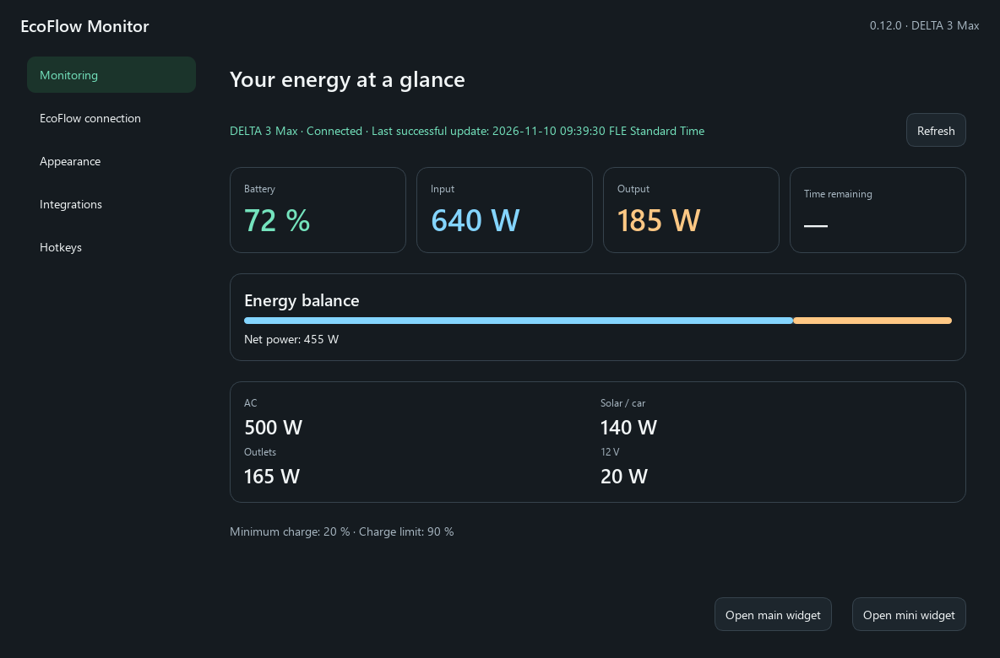

# EcoFlow Monitor

Windows monitoring for **EcoFlow devices**, with optional CLI integrations
and automatic profile selection based on running applications, input power, and
battery charge. Version **0.18.0**.

The application uses the official EcoFlow developer API. DELTA 3 MAX is the
user-confirmed working reference. Other model profiles are untested examples
from the API documentation; see [device profiles](DEVICE_PROFILES.md).



## Install

Download the machine installer or portable ZIP from
[GitHub Releases](https://github.com/get-it-simple/EcoFlow-Monitor/releases).
The installer installs for all users in Program Files and requests administrator
approval. Windows 10 version 1809 or newer and Windows 11 x64 are supported.

For portable use, extract the ZIP to a writable folder and run `EcoFlowMonitor.exe`.
Installed copies save settings and logs in `%LOCALAPPDATA%\EcoFlowMonitor`;
portable copies use their own folder when writable. Updates and uninstall preserve
settings, logs and developer keys. Updates close the installed application safely;
close copies running in other Windows sessions before updating.

Open **Connection → Service** in the dashboard and enter your official EcoFlow developer access/secret keys.
In **Devices**, click **Load my devices**, select your station and its profile, then save. The list contains your bound
devices. Unsupported telemetry formats can be collected in local diagnostic logs
to help add support. Developer keys are different
from an EcoFlow mobile-app email/password.

<details>
<summary>Running from source</summary>

Use Windows and Python 3.11 or newer. From the repository root:

```powershell
py -3.11 -m venv .venv
.\.venv\Scripts\python.exe -m pip install -r requirements-dev.txt
.\.venv\Scripts\python.exe -m pip install --no-deps -e .
.\.venv\Scripts\python.exe -m ecoflow_monitor
```

If Python 3.11 is not installed, choose a newer installed version explicitly.
`--settings <path>` selects another non-secret preferences file.

</details>

<details>
<summary>Features</summary>

## Everyday controls

- The dashboard opens on startup. Use its sidebar for monitoring and settings,
  and enable the adaptive widget when needed. Closing the main window offers
  to save or discard pending changes, then hides it; use the tray menu to exit.
- Launching the application again restores and focuses the dashboard.
  Only one instance runs per user in a Windows session, even from another folder.
- Press **Ctrl+Alt+NumPad 5** to show or hide monitoring. Change this shortcut and
  assign other actions in **Hotkeys**. A shortcut owned by another
  application is reported as unavailable.
- Resize the widget between a minimal numeric display, compact cards, a larger
  display, or a wide row. Choose readings for Small, Large, or only when expanded
  in Appearance; Small readings also appear in Large. Reorder by dragging or
  Move up/Move down. Extra readings open in an attached details panel without
  moving the widget. Controls appear on hover or keyboard focus; the device name
  and full connection status are optional. Drag a free surface to move it.
- The widget has its own scale, background, pin, position lock and click-through. Click-through requires
  the tray menu and a working recovery shortcut. **Ctrl+Alt+W** restores widget
  controls; the tray offers the same action.
- Open **Integrations** to manage modules. Expand **Integrations** in Monitoring to
  select an enabled integration and profile, then click
  **Apply profile**. Manual selection turns off Auto for that integration only.

## Features

- Monitoring cards with input/output power, charge, separate limits, port
  loads, approximate runtime without input power, and estimated time to the charge
  limit while charging (based on input minus output power).
- Optional CLI integrations with their own profiles, activation/deactivation
  actions, ordered rules, and global hotkeys.
- Automatic profile selection using running applications, input power, and
  battery charge, with independent Auto controls for each integration.
- Independent interface and widget scale, adaptive metric visibility, and widget background opacity.
- Graphite surfaces, bundled Inter typography, mint actions and shared controls. Percentage
  settings provide both numeric input and a slider.
- Saved preferences, window placement, and English/Ukrainian interface languages.

### Appearance and monitoring status

Choose Panel, Overlay or Clear for the widget in Appearance. **Background opacity** ranges from
0% (no background) to 100% (solid); Overlay starts at 82%. Text and icons remain
opaque. Clear outlines text and offers a protective background if needed.
Appearance changes preview temporarily; Save keeps them and Cancel restores the
saved appearance. Drafts remain available when switching dashboard pages.

Turn off **Animations** in Appearance to stop energy waves, status motion and
animated value transitions everywhere. Windows animation preferences are also
respected. Animation timing follows elapsed time; heavy load can reduce the number
of displayed frames without slowing the cycle. Clear allows a faint decorative
wave while keeping its base background at 0%.

Enable an optional charge limit with its checkbox, or disable it to leave the
limit unset. Manual limits are local fallback values and never change the station.

A stale/offline status retains the last received readings. Hover over the status
for the last successful retrieval time; this is not a device sample timestamp.

</details>

<details>
<summary>Extra details</summary>

## Integrations and automation

Open **Settings > Integrations > Add integration**, or import a JSON module.
Choose the application's local `.exe` or Windows shortcut, configure its CLI
commands and profiles, then enable the integration and save. Modules can be
edited, exported, or removed without rebuilding the application.

MSI Afterburner is included only as a removable example, disabled by default.

Each integration has independent Auto settings and ordered rules. Application
rules take priority over system rules; the first matching rule wins. Auto waits
for fresh telemetry and an available target application, requires a stable
candidate for five seconds, and allows at least ten seconds between transitions.
An empty rule list leaves the current profile unchanged.

Profile changes run enabled deactivation actions for the previous profile,
followed by activation actions for the new one. Failures stop the transition and
show the command result. **Retry transition** starts the sequence again, so
completed commands may repeat. Disabling an integration or Auto, exiting, losing
fresh telemetry, or finding no matching rule leaves the external state unchanged.
Successful command dispatch does not confirm that an application applied a profile.

Monitoring, integration scans, Auto and animations pause while Windows sleeps,
the session is locked, or its display is off. Work resumes automatically once
Windows is awake, the session is unlocked and the display is on. Auto first waits
for new readings and a new target check, then applies its normal stability delay.
Display dimming alone does not pause work. Saved Auto choices, settings drafts and
window visibility are retained; resuming does not bring windows to the foreground.

EcoFlow Monitor allows Windows to sleep and turn off its display normally. It does
not keep the PC awake, change power settings or schedule wake-ups. A CLI command
already running can finish within its existing timeout; remaining transition
commands are cancelled. A partial transition may repeat completed commands if Auto
selects that profile again after recovery. Key expiry includes time spent asleep;
expired 1Password keys still require **Get new keys**.

Use a profile's **Technical details** field for comments, shown in profile
tooltips. **Export JSON** includes local paths and rules; review paths before
sharing. If an integration requires administrator rights, approve its separate
helper and Windows UAC prompt. Approve only trusted integrations and executables.

## Settings and saved data

Non-secret preferences use `settings.json` beside the portable executable or
source tree, with `%LOCALAPPDATA%/EcoFlowMonitor` fallback if the directory is not
writable. Choose Windows Credential Manager or 1Password for EcoFlow keys;
keys never go in the JSON file. Close the application before editing settings by hand.

For 1Password, install its desktop app and CLI (`op` on PATH), then enable
Windows Hello and **Settings > Developer > Integrate with 1Password CLI** in
1Password. In **Connection → Service**, choose **1Password**, paste the access
and secret fields' **Copy Secret Reference** links (`op://…`), and fill the latest
keys before loading devices. Save settings to keep the references. Monitoring
keeps keys encrypted in temporary Windows storage for 1–168 hours (24 by default).
Every restart clears this cache and requests keys again. When the time expires,
monitoring pauses and shows **Get new keys**, with a tray notification when available.
1Password controls Windows Hello approval. Key references are masked with an
explicit show action. After a failed request, click the main connection status
to request keys again. Existing Windows credentials are retained when switching.

To store a new pair, choose **1Password** and expand **Save entered keys to 1Password**.
Enter both keys in that section, then the vault and item title, and create the
item. This creates a new Login immediately; save settings to use its references.
Canceling settings leaves the created item in your vault.

Settings use **Save**, **Reset draft**, and **Cancel**. A damaged settings file is
preserved; an explicit recovery Save creates `settings.json.bak` before replacing
it. **Connection → Diagnostics** offers Off, Normal (application actions), and Detailed
(API responses and telemetry processing). Save to apply the mode without restarting.
Known sensitive fields are masked while their presence remains visible; new API
fields may need additional masking. **Show log file in Explorer** selects the current
file. Logs stay locally in the settings directory's `logs` folder. A new file starts
on each local calendar day or before exceeding 3 MiB. Archives are kept for up to
14 days and 100 MiB in total. Turning logging off preserves existing files.

At startup, a confirmation lists the planned connection operations and possible
1Password/Windows Hello and administrator-helper/UAC windows. They run sequentially.
Declining pauses automatic access until you explicitly request it. Device discovery
and monitoring share the current credential session. Device names refresh once at
startup and remain available after saving or restarting.

**Collect device diagnostics** requests separate permission to record sanitized
official API responses locally, including when ordinary logging is Off. Nothing is
uploaded, and the saved logging mode stays the same. Review logs before sharing.

## Known limitations

- The verified telemetry profile is based on DELTA 3 Max documentation and a
  supplied runtime log. Other response formats need diagnostic review before
  support can be added. Selective polling still needs live device verification.
  Port power retains the sign supplied by the API.
- Cloud monitoring requires internet, an authorized account-bound device, and
  valid developer keys. Connection settings provide separate update intervals and
  loading ages for main readings, ports and charge limits. Defaults are 30 seconds,
  one minute and five minutes. Widgets request visible readings and dependencies
  of calculations and enabled Auto rules. API failure alone does not prove internet loss.
- Runtime estimates use output power and charge above the discharge floor, only
  with measured zero input and the necessary fresh data. Approximate full-battery
  capacity improves from stable API power, charge-level and remaining-time samples
  during normal monitoring. It is retained per device; manual capacity is the
  fallback until enough samples are available. Charging losses and changing loads
  affect accuracy. Capacity sampling creates no separate polling cycles.
- EcoFlow monitoring is read-only. Manual values and automation never send control
  commands to the station.
- Exclusive-fullscreen games may cover the monitoring widgets.

</details>

<details>
<summary>Supported languages</summary>

| Language | Windows language code |
| --- | --- |
| English | `en` |
| Ukrainian | `uk` |

Choose a language in Settings, or use the system language selected by default.
Language changes take effect when Settings is saved. Missing translations appear
in English.

</details>

<details>
<summary>Contribute a translation</summary>

Copy `ecoflow_monitor/i18n/en/strings.json` into a new Windows-locale directory,
such as `ecoflow_monitor/i18n/de/strings.json`. Translate the values, keep the keys
and placeholders such as `{timestamp}` unchanged, and save the file as UTF-8.
Partial translations are supported through English fallback.

New language catalogs are discovered and packaged automatically; no registry
change is needed. Submit the JSON file to this project on GitHub.

</details>

<details>
<summary>Third-party packages</summary>

| Package | Purpose |
| --- | --- |
| PySide6 | Desktop interface |
| Inter | Bundled interface font; [SIL Open Font License](ecoflow_monitor/ui/assets/fonts/OFL.txt) |
| httpx | Official EcoFlow API requests |
| psutil | Process discovery for integrations and application rules |
| PyInstaller | Portable builds only |
| packaging | Build tooling only |
| pytest | Tests only |
| pytest-xdist | Parallel tests only |

Credentials and global hotkeys use Windows APIs. This independent project is not
affiliated with EcoFlow or MSI.

</details>
