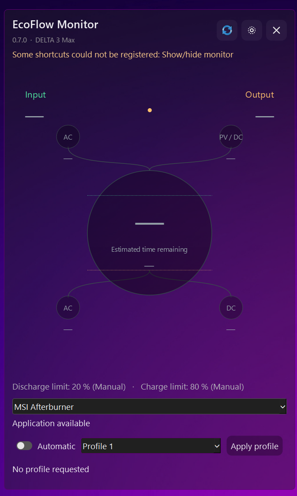

# EcoFlow Monitor

Windows monitoring for **EcoFlow DELTA 3 Max**, with optional CLI integrations
and automatic profile selection based on running applications, input power, and
battery charge. Version **0.11.0**.

The application uses the official EcoFlow developer API. Real-device validation
remains pending.



## Install

Download the machine installer or portable ZIP from
[GitHub Releases](https://github.com/get-it-simple/EcoFlow-Monitor/releases).
The installer installs for all users in Program Files and requests administrator
approval. Windows 10 version 1809 or newer and Windows 11 x64 are supported.

For portable use, extract the ZIP to a writable folder and run `EcoFlowMonitor.exe`.
Installed copies save settings and logs in `%LOCALAPPDATA%\EcoFlowMonitor`;
portable copies use their own folder when writable. Updates and uninstall preserve
settings, logs and developer keys. Updates close the installed application safely;
close copies running in other Windows sessions before updating.

Open Settings, enter your official EcoFlow developer access/secret keys, and click
**Load my devices**. Select your DELTA 3 Max and save. The list contains your bound
devices; telemetry mapping supports DELTA 3 Max only. Developer keys are different
from an EcoFlow mobile-app email/password.

<details>
<summary>Running from source</summary>

Use Windows and Python 3.11 or newer. From the repository root:

```powershell
py -3.11 -m venv .venv
.\.venv\Scripts\python.exe -m pip install -r requirements-dev.txt
.\.venv\Scripts\python.exe -m pip install --no-deps -e .
.\.venv\Scripts\python.exe -m ecoflow_monitor
```

If Python 3.11 is not installed, choose a newer installed version explicitly.
`--settings <path>` selects another non-secret preferences file.

</details>

<details>
<summary>Features</summary>

## Everyday controls

- Open Settings from the top-right button or system tray. Closing the main window
  hides it; use the tray menu to exit.
- Launching the application again restores and focuses the existing window.
  Only one instance runs per user in a Windows session, even from another folder.
- Press **Ctrl+Alt+NumPad 5** to show or hide monitoring. Change this shortcut and
  assign other actions in **Settings > Hotkeys**. A shortcut owned by another
  application is reported as unavailable.
- Enable the mini widget in Appearance and choose which metrics stay visible,
  appear after expanding the arrow, or remain off. Drag to reorder metrics or move
  the widget; screen-edge docking and placement above the taskbar are optional.
- Expand **Integrations** in Settings to manage modules, or in the monitor to
  select an enabled integration and profile, then click
  **Apply profile**. Manual selection turns off Auto for that integration only.

## Features

- Battery flow diagram with input/output power, charge, separate limits, port
  loads, and approximate runtime without input power.
- Optional CLI integrations with their own profiles, activation/deactivation
  actions, ordered rules, and global hotkeys.
- Automatic profile selection using running applications, input power, and
  battery charge, with independent Auto controls for each integration.
- Adjustable interface scale, mini-widget metrics, and background transparency.
- Dark settings dialogs that follow the Windows accent color live. Percentage
  settings provide both numeric input and a slider.
- Saved preferences, window placement, and English/Ukrainian interface languages.

### Appearance and monitoring status

Toggle **Transparent background** in Appearance for a translucent or solid main
background. **Main background transparency** ranges from 0% (solid) to 100%
(invisible background). Text and icons remain visible; Save applies the change
without restarting.

Enable an optional charge limit with **Set value**, or disable it to leave the
limit unset. Manual limits are local fallback values and never change the station.

A stale/offline status retains the last received readings. Hover over the status
for the last successful retrieval time; this is not a device sample timestamp.

</details>

<details>
<summary>Extra details</summary>

## Integrations and automation

Open **Settings > Integrations > Add integration**, or import a JSON module.
Choose the application's local `.exe` or Windows shortcut, configure its CLI
commands and profiles, then enable the integration and save. Modules can be
edited, exported, or removed without rebuilding the application.

MSI Afterburner is included only as a removable example, disabled by default.

Each integration has independent Auto settings and ordered rules. Application
rules take priority over system rules; the first matching rule wins. Auto waits
for fresh telemetry and an available target application, requires a stable
candidate for five seconds, and allows at least ten seconds between transitions.
An empty rule list leaves the current profile unchanged.

Profile changes run enabled deactivation actions for the previous profile,
followed by activation actions for the new one. Failures stop the transition and
show the command result. **Retry transition** starts the sequence again, so
completed commands may repeat. Disabling an integration or Auto, exiting, losing
fresh telemetry, or finding no matching rule leaves the external state unchanged.
Successful command dispatch does not confirm that an application applied a profile.

Use a profile's **Technical details** field for comments, shown in profile
tooltips. **Export JSON** includes local paths and rules; review paths before
sharing. If an integration requires administrator rights, approve its separate
helper and Windows UAC prompt. Approve only trusted integrations and executables.

## Settings and saved data

Non-secret preferences use `settings.json` beside the portable executable or
source tree, with `%LOCALAPPDATA%/EcoFlowMonitor` fallback if the directory is not
writable. Choose Windows Credential Manager or 1Password for EcoFlow keys;
keys never go in the JSON file. Close the application before editing settings by hand.

For 1Password, install its desktop app and CLI (`op` on PATH), then enable
Windows Hello and **Settings > Developer > Integrate with 1Password CLI** in
1Password. In EcoFlow connection settings, choose **1Password**, paste the access
and secret fields' **Copy Secret Reference** links (`op://…`), and fill the latest
keys before loading devices. Save settings to keep the references. Monitoring
reads current keys from 1Password for each API request; 1Password controls approval
and the authorization session. Existing Windows credentials are retained when switching.

To store a newly entered pair, expand **Save entered keys to 1Password** while
using Windows Credential Manager, enter the vault and item title, and create the
item. This creates a new Login immediately; save settings to use its references.
Canceling settings leaves the created item in your vault.

Settings use **Save**, **Reset draft**, and **Cancel**. A damaged settings file is
preserved; an explicit recovery Save creates `settings.json.bak` before replacing
it. Diagnostic logs are kept in the settings directory's `logs` folder without
keys or raw payloads.

## Known limitations

- Only DELTA 3 Max telemetry mapping is supported. Official documentation was
  checked, but monitoring on a real device remains unverified.
- Cloud monitoring requires internet, an authorized account-bound device, and
  valid developer keys. Polling starts at 30 seconds; readings become stale after
  90 seconds without a valid retrieval. API failure alone does not prove internet
  loss.
- Runtime estimates use output power and charge above the discharge floor, only
  with measured zero input and the necessary fresh data. The nominal capacity is
  2048 Wh and can be overridden for local estimates.
- EcoFlow monitoring is read-only. Manual values and automation never send control
  commands to the station.
- Exclusive-fullscreen games may cover the monitoring widgets.

</details>

<details>
<summary>Supported languages</summary>

| Language | Windows language code |
| --- | --- |
| English | `en` |
| Ukrainian | `uk` |

Choose a language in Settings, or use the system language selected by default.
Language changes take effect when Settings is saved. Missing translations appear
in English.

</details>

<details>
<summary>Contribute a translation</summary>

Copy `ecoflow_monitor/i18n/en/strings.json` into a new Windows-locale directory,
such as `ecoflow_monitor/i18n/de/strings.json`. Translate the values, keep the keys
and placeholders such as `{timestamp}` unchanged, and save the file as UTF-8.
Partial translations are supported through English fallback.

New language catalogs are discovered and packaged automatically; no registry
change is needed. Submit the JSON file to this project on GitHub.

</details>

<details>
<summary>Third-party packages</summary>

| Package | Purpose |
| --- | --- |
| PySide6 | Desktop interface |
| httpx | Official EcoFlow API requests |
| psutil | Process discovery for integrations and application rules |
| PyInstaller | Portable builds only |
| packaging | Build tooling only |
| pytest | Tests only |
| pytest-xdist | Parallel tests only |

Credentials and global hotkeys use Windows APIs. This independent project is not
affiliated with EcoFlow or MSI.

</details>
